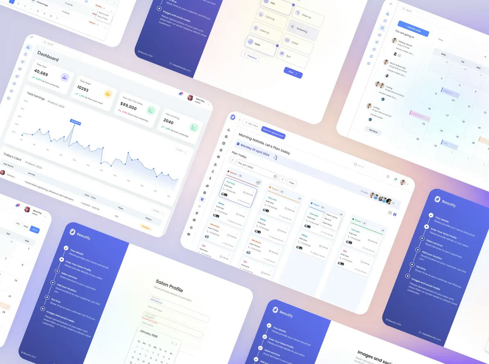
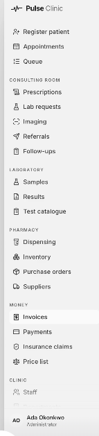

# Plano de Arquitetura e Implementação do MVP — Sora Studio

> **Objetivo:** Plataforma SaaS para clínicas de estética, salões de beleza, barbearias e podologia, focada em **agilidade extrema via celular/WhatsApp**, **gestão financeira real (sem misturar caixa com lucro)** e **arquitetura Zero-Leak (isolamento total contra vazamento de dados)**.

---

## 1. Diagnóstico e Síntese da Pasta `docs/`

A análise completa dos três documentos (`docs/ideia.md`, `docs/pesquisa_mercado.odt` e `docs/matriz_riscos_sistemas_gestao.docx`) revelou os seguintes pilares estratégicos para o **Sora**:

### 1.1. Dores Reais do Mercado (`pesquisa_mercado.odt` & `ideia.md`)
1. **Dependência do WhatsApp e Falta de Tempo:** Profissionais e gestores têm notebook, mas não conseguem parar o atendimento para operar sistemas complexos. Preferem resolver tudo pelo celular.
2. **Fricção para o Cliente Final:** O cliente final não quer baixar aplicativo nem criar conta/senha só para agendar um procedimento.
3. **Efeito Marketplace e "Sequestro" de Dados:** Concorrentes (como Trinks e Booksy) exibem salões concorrentes para o cliente final e dificultam a exportação de dados caso o gestor queira sair.
4. **Cálculo Errado de Comissões e Finanças Misturadas:** Sistemas tradicionais misturam Fluxo de Caixa com Lucro Líquido (DRE) e calculam comissões sobre o valor bruto (ignorando taxa de maquininha, custo de insumos do pacote/serviço e Lei do Salão Parceiro).
5. **Furos de Agenda (No-Show) e Brechas Inválidas:** Falta de validação inteligente de duração de serviço em brechas da agenda e ausência de exigência automática de sinal (Pix) baseada no histórico/comportamento (Score) do cliente.
6. **Baixa Retenção Ativa:** Falta de automações inteligentes, como envio de crédito promocional 7 dias antes do aniversário do cliente para incentivar consumo adicional (upsell) no local.

### 1.2. Lições da Matriz de Riscos dos Concorrentes (`matriz_riscos_sistemas_gestao.docx`)
Para evitar os principais motivos de reclamações no Reclame Aqui (Trinks, Avec, AppBarber, Belle Software, Simples Dental):
- **Portabilidade Garantida (Anti Lock-in):** Exportação limpa em 1 clique (CSV/JSON) de clientes, prontuários, agenda e financeiro (apenas pelo Gestor autenticado).
- **Estabilidade em Dias de Pico (Sexta/Sábado):** Uso de Redis para locks de agendamento, cache de disponibilidade e filas assíncronas idempotentes.
- **Transparência Financeira:** Conciliação clara entre valor bruto, taxas, insumos, comissões e líquido real.

---

## 2. Arquitetura de Segurança "Zero-Leak" (Prevenção Total Contra Vazamento de Dados)

Como o sistema lida com múltiplas clínicas (Multi-Tenant), dados financeiros, fotos clínicas (antes/depois) e agentes de IA no WhatsApp, a segurança foi desenhada em **6 camadas de isolamento (Defense in Depth)**:

### Camada 1: Isolamento Multi-Tenant no Banco de Dados e Redis
- **Row-Level Security (RLS) no PostgreSQL + Role `NOBYPASSRLS`:** Todas as tabelas possuem `tenant_id` (UUID) com políticas RLS nativas do banco ativadas (`ENABLE ROW LEVEL SECURITY` e `FORCE ROW LEVEL SECURITY`). O banco é inicializado (`infra/postgres/init/01-init-rls-roles.sh`) com separação estrita de usuários: o owner (`sora`, via `MIGRATION_DATABASE_URL`) é usado exclusivamente pelo Alembic para migrations DDL, enquanto o FastAPI conecta em runtime com o role `sora_app` (`NOSUPERUSER` + `NOBYPASSRLS`, via `DATABASE_URL`). A cada requisição no FastAPI, uma dependência injeta `SET LOCAL app.current_tenant_id = '<uuid>'` na transação. **Mesmo se houver um bug em uma query SQL/ORM sem filtro `WHERE`, o banco de dados bloqueia qualquer leitura ou escrita de outra clínica.**
- **Isolamento de Chaves no Redis:** Wrapper obrigatório no backend que prefixa todas as operações com `tenant:{tenant_id}:*` (para locks de agenda, cache e filas), impedindo colisão ou leitura cruzada em memória.

### Camada 2: Controle de Acesso Granular em 3 Níveis (RBAC + Escopo Zero-Leak)
O sistema interno possui **3 níveis de acesso autenticados** (tanto no `apps/web` quanto no `apps/mobile`), além do acesso público restrito do cliente final no link leve:

1. **Nível 1 — Dono / Gestor (`OWNER`):**
   - Acesso irrestrito a toda a operação e estratégia da clínica/barbearia.
   - **Exclusivo do Dono/Gestor:**
     - **DRE (Lucro Líquido Real por competência)** e **Saldo em Contas Bancárias / Extrato Consolidado**.
     - **Configuração Cristã (Dízimo e Oferta)** e acompanhamento dos valores provisionados.
     - **Folha de Pagamento / Pró-Labore** e configuração das regras/percentuais de comissão de cada colaborador.
     - **Portabilidade / Exportação da Base de Dados** (protegido com 2FA/senha e log de auditoria, impedindo que funcionários roubem a carteira de clientes).
     - Configurações fiscais da empresa (MEI vs. Clínica/ME) e credenciais de gateway Pix/WhatsApp.

2. **Nível 2 — Admin (`ADMIN`):**
   - Focado na gestão operacional diária da clínica/barbearia (gerente operacional / recepção sênior), com acesso ao Painel Web e ao App Mobile.
   - **O que pode fazer:**
     - Gerenciar a agenda de **todos** os barbeiros/colaboradores (agendar, encaixar, realocar via tela ou Agente IA Copiloto).
     - Cadastrar e editar clientes, gerenciar **Score do Cliente** (liberar/bloquear ou exigir sinal), cadastrar serviços, pacotes e controle de estoque/insumos.
     - Operar o caixa diário: abertura/fechamento de comandas, **Valor Líquido de Venda/Recebimento**, lançamento de entradas/saídas operacionais do dia e conferência de comissões de atendimento.
   - **Bloqueios Zero-Leak (O que NÃO pode fazer):**
     - Não tem acesso à **DRE (Lucro Líquido do Dono)**, ao **Saldo Geral das Contas Bancárias**, ao módulo de **Dízimo/Oferta** nem ao **Pró-Labore do Dono**.
     - **Proibido exportar a carteira de clientes** em massa (CSV/Excel) para evitar vazamento da base.
     - Não pode excluir a empresa nem remover ou rebaixar um usuário `OWNER`.

3. **Nível 3 — Barbeiro / Colaborador (`COLLABORATOR`):**
   - Focado na execução ágil do atendimento pelo App Mobile (e visualização própria no Web).
   - **O que pode fazer:**
     - Visualizar e gerenciar a **sua própria agenda** e registrar seus atendimentos/lançamentos.
     - Usar o **Agente IA Copiloto** por voz/texto para a sua carteira do dia (ex: *"avise a Maria que vou precisar realocá-la para às 16h"*).
     - Alimentar o **Prontuário Multimídia** do cliente que está atendendo (tirar fotos de antes/depois, anexar arquivos/documentos e anotações técnicas).
     - Avaliar o **Score do Cliente** ao final do serviço (carinha positiva/negativa + observação interna).
     - Consultar **exclusivamente as suas próprias comissões** e histórico de produção.
   - **Bloqueios Zero-Leak (O que NÃO pode fazer):**
     - Nunca vê comissões ou faturamento de outros barbeiros/colaboradores.
     - Nunca vê Fluxo de Caixa da empresa, DRE, Extrato Bancário ou Dízimo/Oferta.
     - **Proteção contra roubo de carteira:** Não pode exportar clientes; o telefone completo do cliente fica mascarado (`(11) 9****-1234`), sendo qualquer aviso ao cliente enviado pelo canal oficial do estabelecimento via sistema/agente.

- *(Acesso Externo)* **Cliente Final (`PUBLIC`):** Acessa apenas o link leve no WhatsApp ou conversa com o Agente de WhatsApp para consultar horários livres (booleanos) e seus próprios agendamentos após validação do número.

### Camada 3: Sigilo do Score do Cliente e Regra de Negócio Silenciosa
- O **Score do Cliente** (histórico de no-show, atrasos, inadimplência, "carinha" positiva/negativa e observações privadas do profissional) é **100% confidencial da clínica**.
- **Zero vazamento na API pública:**
  - Se o cliente tiver **score baixo** (ou escolher um serviço que exige sinal), a API pública/WhatsApp **jamais** retorna `"score_baixo"` no payload JSON. Ela retorna apenas `"requires_deposit": true, "deposit_amount": 30.00`, exibindo o QR Code Pix normalmente.
  - Se o cliente estiver **bloqueado para atendimento**, a API pública e o Agente de WhatsApp retornam apenas ausência de horários disponíveis ou orientação neutra de contato com a recepção, sem expor o bloqueio.

### Camada 4: Proteção de Prontuários, Fotos, Documentos e Consentimento (LGPD)
- **Bucket Privado (AWS S3 / Cloudflare R2 em Prod; MinIO em Dev):** Nenhum arquivo, foto de antes/depois ou documento de cliente possui URL pública permanente.
- **Pre-signed URLs Temporárias:** O FastAPI valida o token JWT, o `tenant_id` e o papel do usuário antes de gerar um link assinado com validade de **60 segundos** para visualização no App ou Web.
- **Criptografia de Dados Sensíveis (`ENCRYPTION_KEY`):** Observações clínicas, notas privadas de score e tokens de API (WhatsApp/Pix) são criptografados em nível de coluna no banco (`AES-256-GCM` / `Fernet`) usando a chave `ENCRYPTION_KEY` gerada no bootstrap.
- **Registro de Consentimento LGPD (`lgpd_consents`):** No primeiro agendamento pelo Link Mágico ou na assinatura da ficha de anamnese, o sistema registra o aceite explícito dos Termos de Uso e LGPD (`client_id`, `tenant_id`, `accepted_at`, `ip_address`, `terms_version`, `purposes`: fotos clínicas e avisos via WhatsApp).

### Camada 5: Blindagem dos Agentes de IA (Anti-Prompt Injection)
- **Tools com Escopo Fixado no Código (Hard-bound Context):** O LLM nunca escolhe qual `tenant_id` ou `client_id` consultar. Esses parâmetros são injetados diretamente pelo backend Python a partir da sessão autenticada ou do número de telefone verificado no webhook do WhatsApp.
- **Ocultação de Dados na Agenda:** Quando uma cliente (ex: Márcia) tenta agendar um serviço de 60 minutos em uma brecha de 30 minutos (ex: 13:30, havendo a Joana às 14:00), a função Python retorna ao agente apenas:
  `{"available": false, "reason": "WINDOW_TOO_SHORT", "available_minutes": 30, "required_minutes": 60, "suggested_slots": ["15:00", "16:30"]}`.
  O nome ou existência do agendamento da "Joana" **nunca sai do banco de dados** nem chega ao prompt da IA.

### Camada 6: Contratos Estritos de API e Auditoria
- **Schemas Pydantic Separados por Nível de Acesso:** `PublicResponse` vs. `CollaboratorResponse` vs. `AdminResponse` vs. `OwnerResponse` — impede vazamento acidental de campos extras na serialização JSON.
- **Revogação Instantânea via Redis:** Access Tokens JWT curtos (15 min) + Refresh Tokens no Redis. Ao desligar um barbeiro/colaborador ou admin, sua sessão no App Mobile e Web é invalidada no mesmo segundo.
- **Audit Log Imutável:** Toda visualização de prontuário, edição de score, alteração financeira ou exportação gera registro de auditoria (`who`, `role`, `when`, `ip`, `action`, `resource_id`).

---

## 3. Stack Tecnológica e Estrutura do Monorepo

```text
sora/
├── apps/
│   ├── web/                 # Next.js (App Router) + React + TypeScript + Tailwind + shadcn/ui
│   │   ├── (public)/        # Link leve para WhatsApp (SSR rápido, SEO, Agendamento + Pix QR Code)
│   │   └── (dashboard)/     # Painel Web com RBAC: Dono/Gestor, Admin e Barbeiro/Colaborador
│   └── mobile/              # React Native (Expo Router) + TypeScript
│       ├── (collaborator)/  # Barbeiro/Colaborador: própria agenda, prontuário/câmera, score, voz/IA, sua comissão
│       ├── (admin)/         # Admin: todas as agendas, caixa do dia, clientes/score, serviços e comandos IA
│       └── (owner)/         # Dono/Gestor: visão total + DRE, contas bancárias, folha, dízimo/oferta
├── services/
│   └── api/                 # Python 3.12 + FastAPI + SQLAlchemy 2.0 (Async) + Pydantic v2
│       ├── app/
│       │   ├── core/        # Auth JWT, RBAC (OWNER/ADMIN/COLLABORATOR), RLS Middleware, Redis
│       │   ├── modules/     # tenants, users, clients, schedule, finance, ai_agents, notifications
│       │   └── workers/     # Workers Redis (ARQ/Celery) para WhatsApp, Pix e Aniversários
│       └── migrations/      # Alembic (com scripts de políticas RLS no PostgreSQL)
├── packages/
│   └── shared/              # Contratos OpenAPI / Tipos TypeScript gerados a partir do FastAPI
├── infra/
│   ├── traefik/             # Configuração estática/dinâmica do Traefik v3, middlewares e certificados TLS
│   ├── compose/             # docker-compose.dev.yml, prod.yml e overlay de TLS wildcard
│   ├── scripts/             # bootstrap, deploy, backup e restore
│   └── README.md            # Runbook de instalação e operação
└── .github/workflows/       # CI/CD (build das imagens + deploy via SSH)
```

### Papel de Cada Tecnologia na Stack
- **Traefik v3 (Proxy Reverso, Domínios/Subdomínios e Edge Security):**
  1. **Roteamento de Domínios e Subdomínios via Docker Labels:**
     - `api.sora.app` (`api.sora.localhost` em dev) $\rightarrow$ `services/api` (FastAPI + Webhooks de WhatsApp e Gateway Pix).
     - `app.sora.app` (`app.sora.localhost` em dev) $\rightarrow$ `apps/web` (Painel de Gestão Web para Dono, Admin e Colaborador).
     - `{clinica}.sora.app` (Subdomínio Wildcard por tenant) e `sora.app/{clinica}` (Rota por slug) $\rightarrow$ `apps/web` (Link Leve Público de Agendamento, resolvido pelo `middleware.ts` do Next.js via header `Host`).
  2. **HTTPS / Let's Encrypt Automático (Incluindo Wildcard `*.sora.app`):** Essencial para os webhooks de WhatsApp e Pix e para dar identidade própria a cada clínica/barbearia sem configuração manual de certificados.
  3. **Segurança de Borda (Zero-Leak Edge):** Rate limiting por IP na borda, headers de segurança (`HSTS`, proteção de rotas sensíveis), redirecionamento HTTP $\rightarrow$ HTTPS e isolamento de rede Docker (`PostgreSQL` e `Redis` acessíveis apenas na rede interna, nunca expostos à internet).
- **Python + FastAPI (`services/api`):** Backend assíncrono de alta velocidade, validação rígida de dados com Pydantic v2, controle de permissões em 3 níveis (`OWNER`, `ADMIN`, `COLLABORATOR`), integração nativa com ecossistema de IA (agentes de voz/texto e WhatsApp) e motor financeiro preciso (`Decimal`).
- **PostgreSQL 16:** Banco relacional principal com **Row-Level Security (RLS)** para isolamento multi-tenant, transações ACID para o financeiro e suporte JSONB para fichas personalizadas de anamnese/prontuário.
- **Redis 7:**
  1. **Distributed Locks (`SETNX` / Redlock):** Garante que dois clientes não reservem o mesmo horário simultaneamente.
  2. **Hold de Agendamento com Sinal Pix (TTL):** Reserva o horário temporariamente (ex: 10 minutos) enquanto o cliente paga o QR Code Pix do sinal.
  3. **Filas e Jobs Agendados:** Disparo de mensagens de WhatsApp, processamento de áudios/comandos do agente e rotina diária de lembretes de aniversário (7 dias antes).
  4. **Segurança:** Rate limiting por IP/Telefone e blacklist/rotação de tokens JWT.
- **Next.js / React (`apps/web`):**
  1. **Link Leve no WhatsApp (`{clinica}.sora.app` ou `sora.app/{clinica}`):** Carregamento instantâneo no navegador interno do WhatsApp (iPhone/Safari e Android/Chrome), ótimo SEO para a clínica/barbearia e fluxo de agendamento sem necessidade de instalar app.
  2. **Painel Administrativo Web (`app.sora.app`):** Telas adaptadas conforme o nível de acesso (**Dono/Gestor**, **Admin** ou **Barbeiro/Colaborador**).
- **React Native / Expo (`apps/mobile` — Nativo para iPhone/iOS e Android):**
  - Aplicativo compilado nativamente para **iPhone (iOS / App Store)** e **Android (Google Play)** a partir da mesma base TypeScript (via Expo + EAS Build).
  - Experiência fluida no bolso do **Barbeiro/Colaborador**, **Admin** e **Dono/Gestor**: biometria (FaceID no iPhone / Impressão Digital no Android), notificações push em tempo real (APNs + FCM), gravação de áudio para a **SORA IA**, uso da câmera/galeria para anexar fotos ao prontuário do cliente e fechamento de atendimento em poucos toques.

### 3.1. Identidade Visual, Tema Customizável e Navegação Lateral (UI/UX Design System)

> **Arquivos de Referência Salvos no Repositório:**
> - `docs/plan/imgs/ref-1-visual-dashboard-cores.jpg` — Referência principal de perfil visual, paleta de cores, cards de dashboard, gráficos, agenda diária (*"Plan Today"*) e wizard de onboarding.
> - `docs/plan/imgs/ref-2-menu-lateral-descritivo.png` — Referência obrigatória para a estrutura do menu lateral esquerdo (ícone + texto descritivo agrupado por seções e perfil do usuário no rodapé).

1. **Perfil Visual Moderno "Clean SaaS" (`docs/plan/imgs/ref-1-visual-dashboard-cores.jpg` — Estilo Beautify):**
   - 
   - **Estética e Superfícies:** Interface ultra-moderna, limpa e arejada com fundo claro suave (`#F8FAFC` / `#FFFFFF`), cards com bordas arredondadas generosas (`rounded-2xl`), sombras difusas suaves e tipografia geométrica legível (`Plus Jakarta Sans` / `Inter`).
   - **Componentes de Dashboard e Agenda ("Plan Today"):**
     - Cards de KPI no topo com ícones em badges pastéis (verde menta para crescimento, âmbar para pendências, lavanda/índigo para métricas gerais, rosa suave para alertas) e gráficos de área/linha suaves.
     - Agenda diária estilo *Board / Calendário Visual* com saudação contextual (*"Bom dia, [Nome], vamos planejar o dia"*), colunas organizadas por profissional ou status e cartões de agendamento ricos (tag colorida do serviço, nome e avatar do cliente, horário e status do sinal Pix).
   - **Tema e Cores Personalizáveis em Configurações (Dynamic Theme Engine):**
     - **Cor Padrão:** Azul Royal / Índigo Moderno (`#4F46E5` / `#3B5BDB`) com gradientes suaves.
     - **Customização pelo Gestor/Admin:** Em `Configurações > Aparência`, a clínica pode alterar a cor primária do sistema e do seu Link Leve público (ex: Azul Royal, Lavanda/Roxo, Rosa Estética, Verde Spa, Dourado/Âmbar Barbearia). A cor escolhida é injetada dinamicamente via CSS Variables (`--primary`) no Web e via `ThemeProvider` no App Mobile (iPhone e Android).

2. **Menu Lateral Esquerdo Descritivo e Agrupado (`docs/plan/imgs/ref-2-menu-lateral-descritivo.png` — Estilo Pulse Clinic):**
   - 
   - Em vez de uma barra lateral apenas com ícones soltos, o menu lateral esquerdo segue o padrão **expandido com Ícone + Descrição em Texto**, agrupado por categorias em caixa alta (exibindo apenas o que o nível RBAC do usuário permite):
     - **Topo da Sidebar:** Logo e Nome da Clínica / Studio.
     - **Seção `AGENDA & ATENDIMENTO`:** Agenda do Dia, Novo Agendamento, Fila / Recepção.
     - **Seção `SORA IA & WHATSAPP`:** Conversas da SORA IA (Inbox/Feed), Configurar Atendente IA, Automações & Aniversários.
     - **Seção `CLIENTES & CLÍNICA`:** Clientes & Score, Prontuários & Fotos, Clube de Assinaturas, Serviços & Pacotes, Estoque / Insumos.
     - **Seção `FINANCEIRO` *(filtrado por RBAC)*:** Caixa do Dia / Vendas, Comissões & Folha, DRE (Lucro Líquido), Contas & Extrato, Dízimo & Oferta.
     - **Seção `GESTÃO & SISTEMA`:** Colaboradores, Aparência & Cores, Configurações da Clínica.
     - **Rodapé Fixo da Sidebar:** Avatar/Iniciais do usuário logado + Nome completo + Cargo (`Dono / Gestor`, `Administrador` ou `Colaborador`).

---

## 4. Divisão de Recursos por Plataforma e Nível de Acesso (Matriz RBAC do MVP)

Todos os 3 níveis internos têm acesso tanto ao **App Mobile (`apps/mobile`)** quanto ao **Painel Web (`apps/web`)**, mas com visibilidade e ações estritamente isoladas:

| Módulo / Recurso | Link Web Leve (Cliente Final) | Nível 3: Barbeiro / Colaborador (`App` & `Web`) | Nível 2: Admin (`App` & `Web`) | Nível 1: Dono / Gestor (`App` & `Web`) |
| :--- | :---: | :---: | :---: | :---: |
| **Agendamento & Validação de Tempo** | ✅ (Agenda p/ si) | ✅ (Apenas **sua** agenda) | ✅ (Agenda de **todos**) | ✅ (Agenda de **todos**) |
| **Sinal via QR Code Pix** | ✅ (Paga o Pix) | 🔔 (Vê status na sua agenda) | ✅ (Acompanha e gerencia) | ✅ (Configura regras e contas) |
| **SORA IA — Copiloto Interno (Voz/Texto)** | ❌ | ✅ (Realoca/lança **seus** clientes) | ✅ (Opera agenda geral e caixa do dia) | ✅ (Acesso total + consultas DRE/Caixa) |
| **SORA IA — Atendente WhatsApp & Conversas**| 🔗 (Atendido por ela) | 🔔 (Notificado pela SORA IA) | 💬 (Vê conversas, intervém e configura persona) | ⚙️ (Vê conversas, configura nome/persona e regras) |
| **Prontuário (Fotos, Docs, Textos)** | ❌ | ✅ (Clientes que atende — câmera/upload) | ✅ (Todos os clientes da clínica) | ✅ (Todos os clientes da clínica) |
| **Score do Cliente (Carinha +/- e Nota)**| ❌ *(100% Oculto)* | ✅ (Avalia no pós-atendimento) | ✅ (Avalia, edita score e bloqueia) | ✅ (Configura motor e regras de score) |
| **Telefone Completo / Exportação Base** | ❌ | 🔒 (Telefone mascarado / Sem exportação) | 🔒 (Vê telefone p/ operação / **Sem exportação em massa**) | ✅ (Acesso total + **Exportação 1-click**) |
| **Cadastro de Serviços, Pacotes e Insumos**| 👁️ (Vê serviços e valor médio se ativo) | 👁️ (Consulta catálogo) | ✅ (Cadastra e atualiza serviços/estoque) | ✅ (Define custos, margens e comissões) |
| **Clube / Planos de Assinatura Online** | ✅ (Contrata plano e agenda usando cotas) | 👁️ (Vê se atendimento é de assinante) | ✅ (Gerencia assinantes e uso de cotas) | ✅ (Cria planos, preços, limites e regras) |
| **Comissões** | ❌ | ✅ (Vê **exclusivamente a sua**) | 👁️ (Conferência operacional de repasses) | ✅ (Gestão completa, folha e pró-labore) |
| **Fluxo de Caixa Diário & Venda Líquida**| ❌ | ➕ (Apenas dá baixa no seu serviço) | ✅ (Opera caixa do dia e recebimentos) | ✅ (Visão histórica e consolidada) |
| **DRE (Lucro Líquido Real) & Saldo Bancário**| ❌ | ❌ *(Bloqueado)* | ❌ *(Bloqueado)* | ✅ (**Exclusivo Dono/Gestor**) |
| **Configuração Cristã (Dízimo e Oferta)**| ❌ | ❌ *(Bloqueado)* | ❌ *(Bloqueado)* | ✅ (**Exclusivo Dono/Gestor**) |
| **Automação de Aniversário (Crédito 7d)**| ✅ (Usa crédito) | 👁️ (Vê tag de aniversariante) | ✅ (Aplica/valida crédito na comanda) | ⚙️ (Define valor e regra do crédito) |

---

## 5. Detalhamento das Regras de Negócio Core do MVP

### 5.1. Motor de Agenda Anti-Conflito, Isolamento por Profissional + Score + Sinal
1. **Isolamento Visual de Agenda ("Cada um vê o seu, Gestor vê tudo"):**
   - **Barbeiro / Colaborador (`COLLABORATOR`):** As queries de agenda no FastAPI aplicam filtro rígido `WHERE collaborator_id = current_user.id`. Ele enxerga e opera **somente a própria agenda**, sem acesso aos horários ou clientes dos demais colegas.
   - **Dono / Gestor (`OWNER`) e Admin (`ADMIN`):** Enxergam a grade completa multi-profissional (visão lado a lado ou filtrada por colaborador) tanto no Web quanto no Mobile.
2. **Garantia Dupla de Zero Conflito de Horários (Anti-Double Booking):**
   - **Nível 1 (Memória / Tempo Real) — Lock Distribuído no Redis:** Ao clicar para confirmar um horário (`collaborator_id` + `intervalo`), o Redis aplica um lock atômico (`SET NX EX`). Se dois clientes tentarem agendar o mesmo horário no mesmo milissegundo, o segundo é bloqueado imediatamente.
   - **Nível 2 (Banco de Dados) — Restrição Nativa PostgreSQL (`EXCLUDE USING gist`):** A tabela `appointments` terá uma constraint `EXCLUDE USING gist (tenant_id WITH =, collaborator_id WITH =, tstzrange(starts_at, ends_at, '[)') WITH &&) WHERE (status NOT IN ('CANCELLED', 'EXPIRED'))`. É matematicamente impossível gravar dois agendamentos sobrepostos para o mesmo profissional.
3. **Validação de Duração Real (Anti-Colisão em Brechas):**
   - Cada serviço possui `duration_minutes` (ex: 60 min) e `buffer_minutes` opcional (tempo de limpeza/preparação).
   - Se há um atendimento às 14:00 e a cliente tenta agendar às 13:30 um serviço de 60 min, o motor detecta que `14:00 - 13:30 = 30 min < 60 min`.
   - O sistema informa de forma amigável que o serviço exige 1 hora e mostra apenas horários onde os 60 minutos cabem integralmente.
4. **Verificação Automática de Score e Sinal:**
   - **Bloqueado (`is_blocked = true`):** O sistema impede o agendamento sem expor o motivo interno.
   - **Exigência de Sinal (`requires_deposit`):** Ocorre se **(a)** o serviço escolhido exige sinal por padrão **OU** **(b)** o Score do cliente está abaixo do limite mínimo configurado pela clínica (calculado por faltas anteriores, cancelamentos em cima da hora ou avaliação negativa registrada pelo profissional após o atendimento).
   - Quando exigido, o horário entra em status `PENDING_DEPOSIT` com lock no Redis (TTL de 10 min) e gera um **QR Code Pix Copia e Cola** (via adaptador de pagamento).

### 5.2. SORA IA: Atendente Virtual no WhatsApp, Central de Conversas (Estilo Mangomint) e Copiloto Interno (`PydanticAI`)

#### Branding e Posicionamento: **SORA IA**
Assim como plataformas globais de referência (ex: Mangomint e sua recepcionista de IA), a inteligência artificial oficial da plataforma terá marca e destaque próprio: **SORA IA**.
- **Slogan e Proposta de Valor:** A **SORA IA** atua 24/7 como a recepcionista virtual da clínica/barbearia no WhatsApp (convertendo conversas em agendamentos preenchidos na agenda sem perder oportunidades enquanto a equipe está atendendo) e como Copiloto de Voz/Texto no bolso do profissional (iPhone e Android).
- **Nome Personalizável do Agente Atendente por Clínica:** Embora o motor e a marca sejam **SORA IA**, o Administrador/Gestor pode configurar o **nome de apresentação do atendente virtual** da sua clínica (ex: *"Bia"*, *"Carol"*, *"Lucas"*, *"Atendente Studio X"* ou manter *"Sora"*), além do tom de voz, mensagem de boas-vindas e instruções específicas do negócio.

#### Escolha Tecnológica para a SORA IA: Por que `PydanticAI` + Redis (em vez de LangChain puro ou CrewAI)?
Para um sistema multi-tenant com exigência **Zero-Leak** e **baixo custo de tokens**, avaliamos as principais tecnologias do mercado Python:
- **LangChain (Clássico):** *Descartado.* Possui abstrações excessivas que ocultam o prompt real, dificultam a auditoria de segurança e adicionam overhead desnecessário.
- **CrewAI / AutoGen:** *Descartados.* Focados em múltiplos agentes conversando entre si, o que multiplica o gasto de tokens e aumenta a latência (inviável para um barbeiro/esteticista esperando resposta rápida no celular).
- **LangGraph:** *Boa alternativa para fluxos longos em grafo*, porém mais verboso para operações diretas de API.
- **PydanticAI (ESCOLHIDO — Padrão Ouro com FastAPI):**
  1. **Segurança Zero-Leak Nativa (`RunContext`):** Criado pela mesma equipe do Pydantic (base do FastAPI). Permite injetar dependências críticas (`tenant_id`, `user_id`, `role` e sessão do banco com RLS) diretamente via código Python nas *tools* (`@agent.tool`), **totalmente fora do alcance do LLM**. É impossível um *Prompt Injection* alterar o `tenant_id` ou consultar a agenda de outro colaborador.
  2. **Saídas 100% Estruturadas e Determinísticas:** O agente devolve schemas Pydantic validados (ex: `RescheduleProposal`, `FinancialEntryDraft`), eliminando alucinações no front-end (`apps/mobile` e `apps/web`).
  3. **Leveza, Economia de Tokens e Agnóstico de Modelo:** Sem prompts ocultos pesados; permite alternar facilmente entre modelos rápidos e baratos (ex: `GPT-4o-mini`, `Gemini 2.5 Flash`, `Claude Haiku`) e usar **Whisper (OpenAI/Groq)** para transcrever áudios do profissional em menos de 1 segundo.
  4. **Human-in-the-Loop via Redis:** Quando o profissional pede uma ação sensível (ex: realocar cliente ou lançar despesa), o agente valida os dados, salva o rascunho da ação no Redis (`tenant:{id}:ai_action:{uuid}`, TTL 5 min) e exibe um card de confirmação de 1 toque no App.

#### Funcionamento na Prática:
1. **Economia Inteligente no WhatsApp (Roteador Determinístico + Link Mágico em `apps/web`):**
   - Trocar dezenas de mensagens no WhatsApp encarece o custo de API do WhatsApp e o consumo de tokens de IA.
   - **Camada 0 (Sem custo de IA):** Quando o cliente manda um "Oi" ou "Quero agendar" no WhatsApp da clínica/barbearia, um roteador determinístico no FastAPI (sem gastar tokens de LLM!) identifica o número do remetente, gera um **Token Mágico Temporário no Redis** (TTL de 20 minutos, vinculado ao `tenant_id` e ao telefone validado) e responde em **uma única mensagem** (assinada com o nome configurado para o agente da clínica) com o link curto personalizado (`[clinica].sora.app?t=[token]` ou `sora.app/[clinica]?t=[token]`).
   - Ao tocar no link, o navegador abre a página ultra-leve (`apps/web`) **com o cliente já autenticado e validado**. Lá ele escolhe o serviço (vendo valores médios, se ativo), profissional, horário livre validado, contrata assinatura ou paga o sinal.
   - **Camada 1 (SORA IA com `PydanticAI` no WhatsApp):** O LLM só é acionado quando o cliente envia uma dúvida aberta ou áudio (ex: *"qual o valor médio da limpeza de pele e tem vaga quinta à tarde?"*). A **SORA IA** responde a dúvida consultando apenas os slots booleanos livres, pode agendar/reagendar diretamente ou entregar o Link Mágico pré-selecionado naquele serviço/dia.
2. **Sessão "Central SORA IA & Conversas" no Painel Web e App (Inspirado no Mangomint):**
   - Uma sessão dedicada no menu lateral (`SORA IA & WHATSAPP`) para dar transparência total e controle ao Gestor e ao Admin:
     - **Resumo Diário da SORA IA ("Enquanto você atendia..."):** Card de destaque no topo mostrando o impacto em tempo real (ex: *"Bom dia! Hoje a SORA IA (Bia) atendeu 14 conversas, realizou 6 novos agendamentos, 2 reagendamentos e tirou 5 dúvidas"*).
     - **Feed / Inbox de Conversas do Atendente IA:** Lista todas as conversas conduzidas pelo agente no WhatsApp com tags visuais automáticas (`Agendado pela SORA IA`, `Reagendado`, `Dúvida Respondida`, `Aguardando Sinal Pix`, `Escalonado para Humano`). Ao clicar, o Admin/Gestor vê o diálogo completo entre o cliente e a IA.
     - **Escalonamento Inteligente ("Precisa de Aprovação / Assumir Conversa"):** Quando um cliente pede uma exceção à regra (ex: *"acordei doente hoje, consegue reagendar sem cobrar a taxa/sinal?"*), a **SORA IA** consulta o histórico/score do cliente, coloca a conversa em `Precisa de Aprovação`, mostra uma nota contextual ao Admin/Gestor (ex: *"Cliente fiel com 12 agendamentos concluídos e nenhuma falta"*) e permite aprovar com 1 clique ou assumir a conversa manualmente.
     - **Aba de Configurações do Agente Atendente:** Onde o Gestor/Admin define:
       - **Nome do Agente Atendente** (ex: *"Bia"*, *"Sora"*, *"Lucas"*).
       - **Tom de Voz e Saudação Personalizada** (ex: mais formal para clínica médica/estética ou mais descontraído para barbearia).
       - **O que a SORA IA sabe (Base de Conhecimento & Regras):** Exibição ou não de valores médios, política de cancelamento/atraso, informações de estacionamento/endereço e sugestões de upsell (ex: *"quando agendar corte, sugerir hidratação ou plano de assinatura"*).
3. **SORA IA Copiloto no App Mobile iPhone/Android (Para Barbeiro/Colaborador, Admin e Gestor):**
   - O profissional fala (áudio transcrito via Whisper) ou escreve no App: *"Avise a Maria que vou precisar realocá-la para às 16h"*.
   - A **SORA IA** usa o `RunContext` blindado (se for `COLLABORATOR`, busca apenas na agenda dele; se for `OWNER`/`ADMIN`, pode especificar o profissional), valida que as 16h não geram conflito, move o agendamento após confirmação rápida e dispara a notificação no WhatsApp para a Maria com link de confirmação em 1 clique.

### 5.3. Planos de Assinatura / Clube de Recorrência Online
1. **Criação de Planos pelo Dono/Gestor:**
   - Configuração de planos recorrentes (ex: *"Clube Barba & Cabelo Ilimitado"*, *"Plano Podologia Mensal"*, *"Clube Estética 4 Sessões/mês"*).
   - Definição de: valor mensal/trimestral, serviços incluídos, limite de usos por ciclo (ex: 4 cortes/mês ou ilimitado com intervalo mínimo de X dias), dias da semana permitidos (ex: terça a quinta) e regra de comissão do colaborador por atendimento de assinante.
2. **Contratação Online pelo Cliente Final (`apps/web`):**
   - No link leve da clínica/barbearia, o cliente pode visualizar a vitrine de **Planos de Assinatura**, contratar online e já agendar seu primeiro horário usando os benefícios do plano.
3. **Consumo Automático de Cotas na Agenda:**
   - Quando um cliente assinante ativo agenda pelo link leve, o sistema reconhece sua assinatura, abate 1 uso da cota mensal daquele serviço (ex: `2 de 4 utilizados`), dispensa cobrança avulsa no agendamento e sinaliza na agenda do barbeiro/colaborador a tag `ASSINANTE`.
4. **Arquitetura Desacoplada de Gateway de Pagamento (Gateway Real na Fase Final):**
   - O módulo de pagamentos (tanto para **Sinal Pix** quanto para **Cobrança Recorrente de Assinaturas**) usará o padrão **Payment Provider Adapter** (`PaymentGatewayPort`).
   - Nas primeiras fases do MVP, funcionará com um **Provider Mock / Pix Chave Direta Manual** para validar todo o fluxo de ponta a ponta (reserva na agenda, ativação de assinatura, controle de cotas, financeiro e DRE). Na fase final, basta plugar a credencial do gateway escolhido (Asaas, Mercado Pago, Pagar.me, Stripe ou Efí) sem alterar nenhuma regra de negócio.

### 5.4. Gestão Financeira Desacoplada (Zero Mistura de Conceitos)
O módulo financeiro será construído em formato de **Dashboard modular**, separando rigorosamente as 5 visões exigidas em `docs/ideia.md`:

1. **Card/Tela 1 — Saldo do Fluxo de Caixa (Regime de Caixa):**
   - Fórmula: `Entradas Reais no Período - Saídas Reais no Período`.
   - Mostra quanto dinheiro entrou e saiu efetivamente no recorte selecionado (incluindo recebimentos avulsos, pacotes e mensalidades de assinaturas recebidas).
2. **Card/Tela 2 — DRE Simplificada (Regime de Competência — Lucro Líquido Real):**
   - **Acesso Exclusivo do Dono/Gestor (`OWNER`).** Considera a data em que o serviço/fato gerador ocorreu:
     - `(+) Receita Bruta de Serviços, Pacotes, Assinaturas e Produtos`
     - `(-) Deduções, Impostos e Taxas de Cartão/Pix`
     - `(-) Custo de Insumos / Pacotes e Comissões de Parceiros`
     - `(-) Despesas Operacionais e Fixas do Período`
     - `(=) Lucro Líquido (ou Prejuízo Líquido) do Exercício`
3. **Card/Tela 3 — Folha de Pagamento, Pró-Labore e Comissões (RH / Colaboradores):**
   - Isolado do fluxo geral: mostra comissões apuradas por profissional (descontando taxas/insumos conforme regra configurada e rateio de atendimentos de assinatura), adiantamentos, salários líquidos e pró-labore. O colaborador vê apenas o seu próprio extrato de comissão.
4. **Card/Tela 4 — Valor Líquido de Venda / Recebimento:**
   - Em cada comanda/venda ou conta a receber, exibe claramente: **Valor Bruto** $\rightarrow$ **Descontos/Taxas (maquininha, imposto)** $\rightarrow$ **Valor Líquido a Receber**.
5. **Card/Tela 5 — Saldo em Contas / Extrato:**
   - **Acesso Exclusivo do Dono/Gestor (`OWNER`).** Mostra a disponibilidade imediata hoje em cada conta bancária cadastrada e na gaveta/caixa físico.
6. **Módulo Opcional em Configurações — Dízimo e Oferta (Gestor Cristão):**
   - **Acesso Exclusivo do Dono/Gestor (`OWNER`).** Toggle em Configurações da Clínica (`enable_tithe_and_offering`, desativado por padrão).
   - Quando ativado pelo gestor, permite configurar a base de cálculo do **Dízimo (10%)** (sobre o Lucro Líquido da DRE ou sobre a Receita Líquida do gestor) e definir um valor ou percentual para **Oferta**, exibindo um card dedicado de provisão e controle de entrega no Dashboard Financeiro.

---

## 6. Roadmap de Execução do MVP (Fases)

### Fase 1: Fundação Zero-Leak, Traefik (Proxy/Domínios), RBAC 3 Níveis, Banco Multi-Tenant e Cadastros Base
- Configuração do monorepo (`services/api`, `apps/web`, `apps/mobile`, `infra/traefik`) e Docker Compose (`traefik`, `postgres`, `redis`, `api`, `web`).
- Configuração do **Traefik v3** para roteamento de domínios e subdomínios (`api.sora.app`, `app.sora.app`, wildcard `{clinica}.sora.app` e fallback `sora.app/{clinica}`), SSL automático (Let's Encrypt) e middlewares de segurança/Rate Limit.
- Autenticação JWT + Refresh Token no Redis + Middleware PostgreSQL RLS (`tenant_id`) + RBAC em 3 níveis (`OWNER`, `ADMIN`, `COLLABORATOR`).
- Cadastro de Empresa (modo simplificado para **MEI** vs. Completo), Usuários e Colaboradores (regras de comissão).
- Cadastro de Serviços, Pacotes e **Planos de Assinatura** (duração, valor, limites de uso, toggle de valor médio, custo de insumo e sinal).
- Cadastro de Clientes com Score e Prontuário Multimídia seguro (upload privado com Pre-signed URLs).

### Fase 2: Motor de Agenda Anti-Conflito, Assinaturas, Score e Link Mágico
- Motor de disponibilidade com validação de duração contínua (anti-brecha curta), isolamento por colaborador (`COLLABORATOR` vê só a sua, `OWNER`/`ADMIN` veem tudo) e dupla trava anti-conflito (Redis Lock + PostgreSQL `EXCLUDE USING gist`).
- Geração do **Link Mágico de Validação** no Redis para autenticação econômica e instantânea do cliente via WhatsApp.
- Motor de **Clube de Assinatura** (contratação online, controle de cotas de serviços no agendamento) + Motor de Score do Cliente e Sinal (usando *Payment Adapter* em modo Mock/Pix Direto).

### Fase 3: Aplicações Front-end (`apps/web` e `apps/mobile` iOS/Android) e Design System Customizável
- **Design System "Clean SaaS" + Tema Dinâmico:** Implementação do visual moderno (estilo Beautify com cor primária customizável nas configurações da clínica) e **Menu Lateral Esquerdo Descritivo** (estilo Pulse Clinic, com ícone + texto agrupado por seções e rodapé com perfil/cargo).
- **`apps/web` (Link Leve WhatsApp):** Página pública ultra-leve com validação via Link Mágico, agendamento sem conflito, vitrine e contratação online de **Planos de Assinatura** e tela de Sinal Pix.
- **`apps/mobile` (Expo Nativo para iPhone/iOS e Android - 3 Níveis):** App nativo adaptado por perfil (`Barbeiro/Colaborador` vendo apenas sua agenda e comissão; `Admin` operando agendas e caixa do dia; `Dono/Gestor` com visão total), prontuário com câmera e avaliação rápida de score pós-atendimento.
- **`apps/web` (Painel Administrativo):** Gestão completa de cadastros, planos de assinatura, agenda multi-profissional ("Plan Today") e prontuários.

### Fase 4: Módulo Financeiro Desacoplado (Dashboards)
- Implementação das 5 visões financeiras separadas (Fluxo de Caixa, DRE por Competência, Folha/Comissões, Valor Líquido de Venda e Saldo em Contas/Extrato).
- Implementação da opção configurável de Dízimo e Oferta no painel exclusivo do `Dono/Gestor`.
- Funcionalidade de Exportação Transparente de Dados (Portabilidade em 1 clique exclusiva para o `Dono/Gestor`).

### Fase 5: SORA IA (Copiloto, Atendente WhatsApp & Central de Conversas), Aniversários e Gateway Final
- **SORA IA Copiloto no App Mobile (iPhone e Android):** Comando por voz/texto para realocar clientes sem conflito, avisar no WhatsApp e registrar lançamentos.
- **SORA IA Atendente de WhatsApp + Central de Conversas (Estilo Mangomint):** Sessão dedicada com resumo diário de atendimentos da IA, histórico de conversas com clientes, escalonamento para aprovação humana e tela de configuração do nome/persona do agente atendente pelo Admin/Gestor.
- Worker agendado no Redis para identificar aniversariantes 7 dias antes e enviar mensagem com crédito promocional configurável.
- **Integração do Gateway de Pagamento Real** (plugando o provedor definitivo no `PaymentGatewayPort` para Pix dinâmico, cobrança recorrente dos planos de assinatura e webhooks automáticos).
